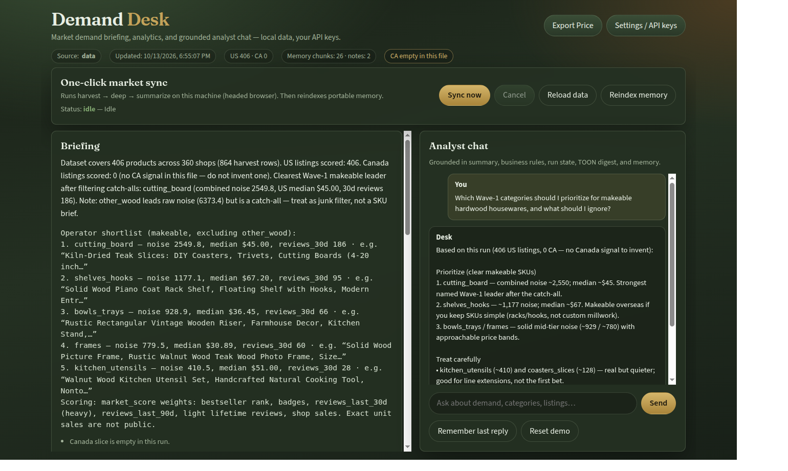
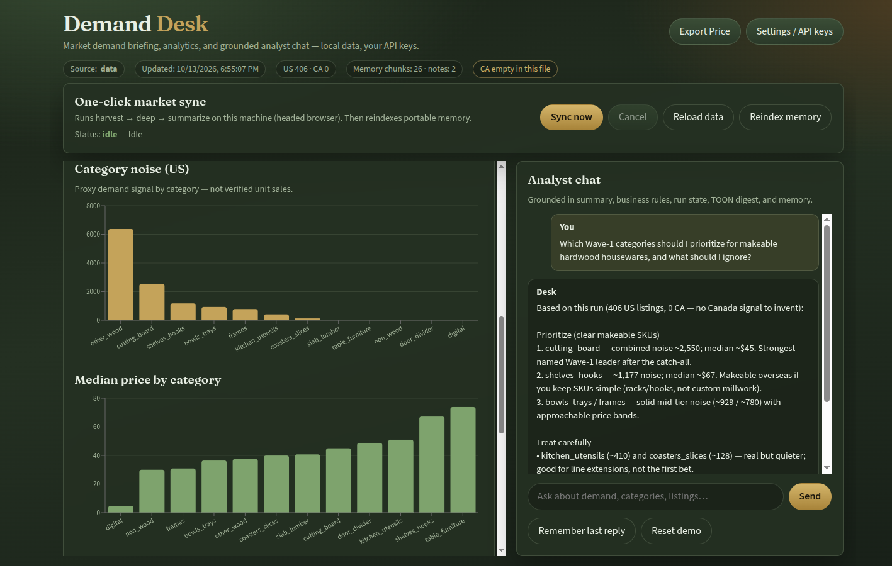
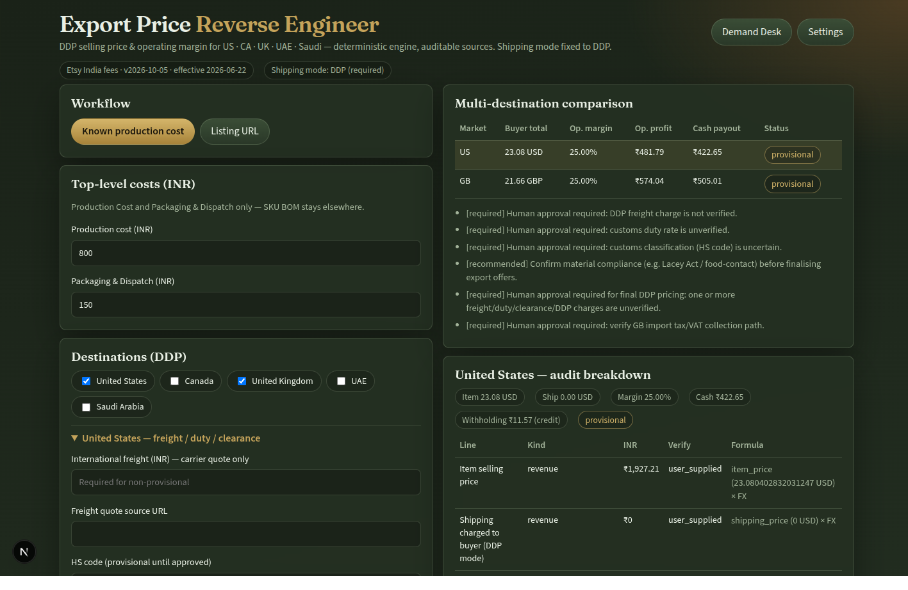
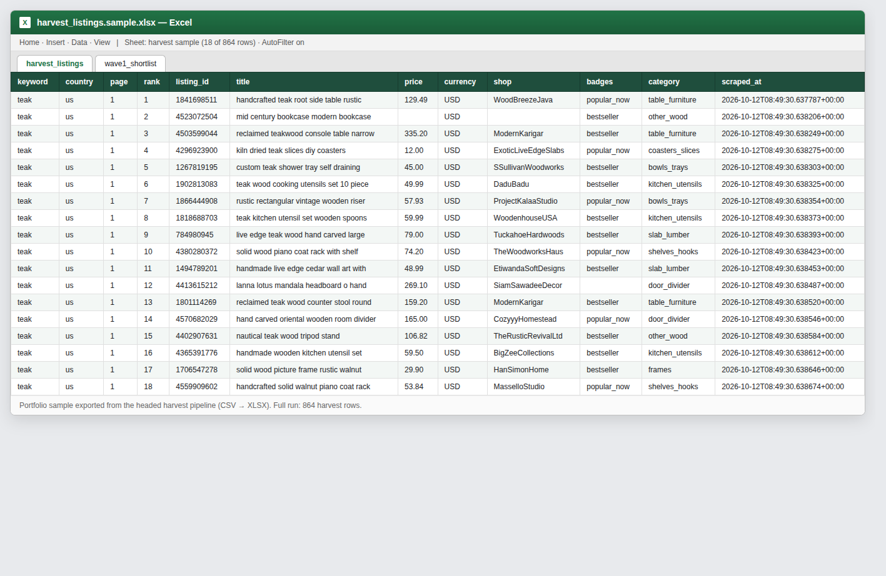
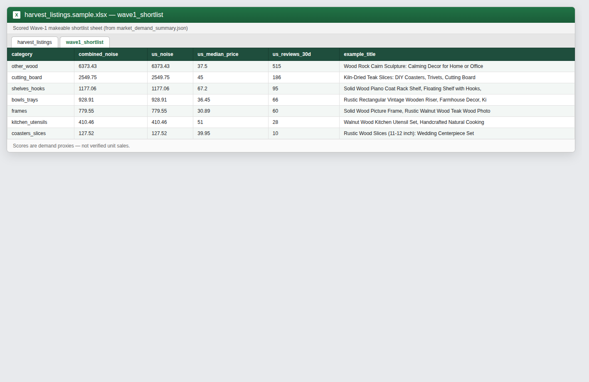
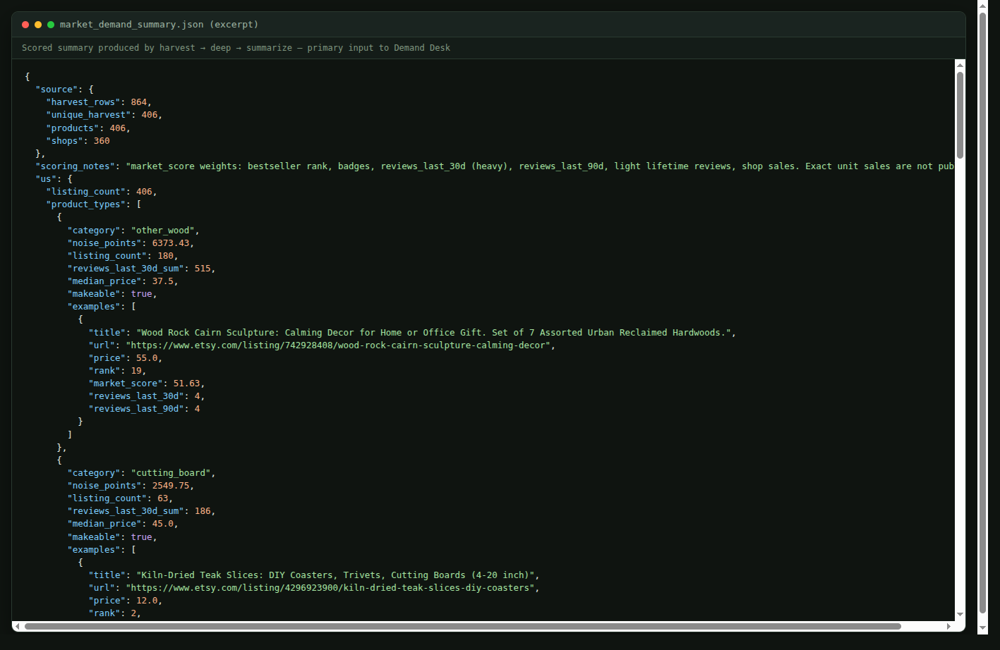
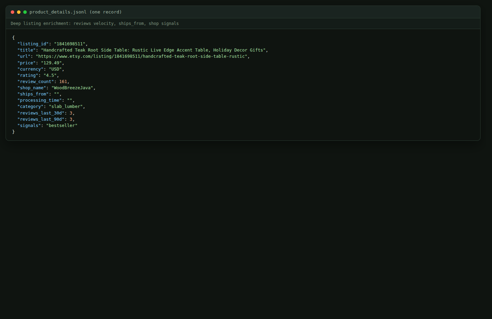

# Demand Desk

I built this for a private client who needed marketplace demand research turned into operating intelligence — scrape → score → brief → chart → grounded chat — with portable memory and bring-your-own API keys.

Client name and commercial terms stay confidential. This repo is my public case study for Upwork and similar platforms.

> Harvest → score → AI demand desk over marketplace demand proxies — briefing, analytics, sync, and memory the client owns.



## What I delivered

| Surface | Purpose |
|---------|---------|
| **Briefing** | Executive + operator views with explicit caveats |
| **Analytics** | Category noise & price charts + Wave‑1 shortlist table |
| **Chat** | Vercel AI SDK agent grounded in data, business rules, run state, TOON digest, retrieved memory |
| **Export Price** | DDP reverse-engineer / cost-plus pricing for US·CA·UK·UAE·SA (auditable fees & tax) |
| **Sync** | One-click local scrape (headed browser on the same machine as the desk) |
| **Settings** | Enter OpenAI + proxy/scrape keys in the UI — no SaaS key vault |
| **Memory** | Portable pack: business rules, analyst notes, TOON digest, local vector index |

Offline metrics (briefing + charts) work **without** an LLM key. Chat and embedding reindex need an OpenAI key in Settings.





## Scrape deliverables (CSV / Excel / JSON)

When I bid on scraping work, clients usually want proof of **structured outputs**, not only a dashboard. This engagement produced client-ready artifacts at each stage:

| Artifact | What it is |
|----------|------------|
| `harvest_listings.csv` → `.xlsx` | Search harvest: keyword, geo, rank, listing id, title, price, shop, badges, category |
| `product_details.jsonl` | Deep listing enrichment (reviews velocity, ships_from, shop signals) |
| `market_demand_summary.json` | Scored summary fed into Demand Desk |

Sample files you can open locally:

- [`fixtures/harvest_listings.sample.xlsx`](fixtures/harvest_listings.sample.xlsx) — Excel with `harvest_listings` + `wave1_shortlist` sheets  
- [`fixtures/market_demand_summary.excerpt.json`](fixtures/market_demand_summary.excerpt.json) — truncated scored summary  
- [`fixtures/product_details.sample.json`](fixtures/product_details.sample.json) — one deep-listing record  









## Problem → approach

**Problem:** Operators needed “what’s making noise and what’s makeable” without mistaking keyword tools for verified unit sales (usually not public).

**Approach:** Geotargeted bestseller harvest → listing/shop deep scrape → proxy scores → Demand Desk briefing, analytics, and grounded Q&A.

**Differentiator:** Portable memory travels with the dataset; Sync runs where the headed browser lives; keys stay local (BYOK).

**Honesty:** Scores are proxies; empty geo slices and catch-all categories are called out in UI and chat.

## Quick start — Demand Desk

```bash
cd etsy-demand-agent
python3 -m venv .venv
.venv/bin/pip install -r browser_scrape/requirements.txt

cd app
npm install
npm run desk                  # http://localhost:3000
```

1. Open **Settings** → paste an **OpenAI API key** (and proxy credentials if you will Sync).
2. Desk loads `data/market_demand_summary.json` if present, otherwise the demo fixture.
3. Use **Reindex memory** once (with OpenAI set) so chat retrieval uses vectors.
4. The home screen opens with a sample grounded Q&A; ask your own follow-ups, or use **Reset demo**.

Demo fixture: [`fixtures/market_demand_summary.sample.json`](fixtures/market_demand_summary.sample.json)

## Quick start — scrape pipeline (or Sync in UI)

```bash
cd etsy-demand-agent
cp config.example.json config.json   # or save keys via Desk Settings
.venv/bin/python -m browser_scrape.run_harvest --countries us,ca --pages 2
.venv/bin/python -m browser_scrape.run_deep --limit 0
.venv/bin/python -m browser_scrape.run_summarize
```

Full scrape details: [`browser_scrape/RUNBOOK.md`](browser_scrape/RUNBOOK.md)

**Sync in the UI** runs the same modules on the host where `npm run desk` is running (headed Chrome must be available there).

## Repo layout

| Path | Purpose |
|------|---------|
| [`app/`](app/) | Demand Desk (Next.js + Vercel AI SDK) |
| [`browser_scrape/`](browser_scrape/) | Headed Playwright / Chrome harvest → deep → summarize |
| [`data/`](data/) | Local scrape outputs + `memory/` + secrets (gitignored where needed) |
| [`fixtures/`](fixtures/) | Safe sample summary, Excel/JSON excerpts, sample memory for demos |
| [`docs/`](docs/) | Architecture, data model, portfolio case study, screenshots |
| [`REQUIREMENTS.md`](REQUIREMENTS.md) | Product / engineering brief |

## Portable memory

```text
data/memory/
  business.json       # editable business / Wave-1 / compliance context
  run_digest.toon     # TOON projection of the current summary (LLM-cheap)
  notes.jsonl         # durable analyst conclusions
  vectors.sqlite      # local embeddings index (gitignored)
```

Export a run by copying `market_demand_summary.json` + `data/memory/` together — another machine keeps analyst context without re-teaching a general chatbot.

## Docs

- [`docs/PORTFOLIO.md`](docs/PORTFOLIO.md) — Upwork-ready case study blurb
- [`docs/ARCHITECTURE.md`](docs/ARCHITECTURE.md) — desk + scrape + memory flow
- [`docs/DATA_MODEL.md`](docs/DATA_MODEL.md) — conceptual ER (docs only; no graph UI)
- [`docs/EXPORT_PRICE.md`](docs/EXPORT_PRICE.md) — Export Price Reverse Engineer (DDP engine)

## Important caveats

- Scores are **proxies** (rank, badges, recent reviews). Exact marketplace unit sales are usually not public — never present them as verified volume.
- Catch-all categories (e.g. `other_wood`) can dominate noise; prefer named Wave‑1 SKUs for production advice.
- Geography slices may be empty (e.g. CA); the UI and agent must say so, not invent.

## Public GitHub checklist

1. Confirm `config.json` and `data/desk-secrets.json` are **not** tracked
2. No `data/chrome_profile_*`, proxy passwords, or debug HTML
3. Prefer committing `fixtures/` + code + docs + screenshots; keep bulky scrape dumps local
4. Add LICENSE when you publish

## Spec

Implementing details and acceptance prompts: [`REQUIREMENTS.md`](REQUIREMENTS.md).
