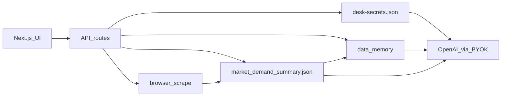

# Architecture — Demand Desk

I designed Demand Desk as a **local** Next.js application: it reads scored marketplace demand summaries, presents analyst surfaces (briefing, charts, Wave‑1), and runs a **Vercel AI SDK** chat agent grounded in data + portable memory. Optional **one-click Sync** spawns the Python scrape pipeline on the same machine (headed browser stays local).



## Components

| Piece | Role |
|-------|------|
| `app/` (Next.js) | UI + API: `/api/data`, `/api/chat`, `/api/sync`, `/api/settings`, `/api/memory`, `/api/export-price/*` |
| Export Price | Deterministic DDP pricing engine (`lib/exportPrice`) + `/export-price` UI — see [`EXPORT_PRICE.md`](EXPORT_PRICE.md) |
| `browser_scrape/` | Harvest → deep → summarize producers |
| `data/market_demand_summary.json` | Primary analyst dataset |
| `data/run_state.json` | Job / scrape pointer |
| `data/memory/` | Portable memory pack (TOON, notes, vectors) |
| `data/desk-secrets.json` | BYOK secrets (gitignored); mirrored to `config.json` for Python |

## Chat path

1. Load summary + `run_state` + business memory.
2. Ensure TOON `run_digest.toon` exists.
3. Retrieve top‑k memory chunks (embeddings if OpenAI key present; else keyword).
4. `streamText` with instructions = system context; stream UI messages via Vercel AI SDK.

## Sync path

1. UI **Sync now** → `POST /api/sync`.
2. Spawn `python -m browser_scrape.run_harvest` → `run_deep` → `run_summarize` (venv preferred).
3. Progress written to `data/sync_status.json`; UI polls.
4. On success, reindex memory (TOON + vectors).

Headed Chrome must run where the desk backend runs — not on a remote serverless host.

## Memory path

- **business.json** — plan / materials / Wave‑1 / compliance footnotes
- **run_digest.toon** — Token-Oriented Object Notation projection of the summary
- **notes.jsonl** — durable analyst conclusions (“Remember last reply”)
- **vectors.sqlite** — chunk embeddings for retrieval

No knowledge-graph database. Relationships are implied by category IDs and note tags; see [`DATA_MODEL.md`](DATA_MODEL.md).

## One-command demo

```bash
cd app && npm install && npm run desk
```

Open http://localhost:3000 — fixture loads if `data/` summary is missing. Add an OpenAI key in Settings for live chat (the home screen ships with a sample grounded Q&A for demos).
