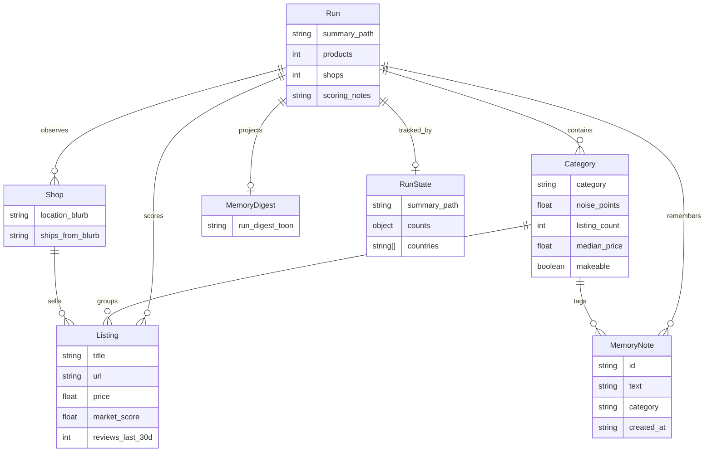

# Data model (conceptual ER)

I use this diagram when walking reviewers through the system. **Demand Desk v1 does not ship a knowledge-graph database or interactive ER explorer** — the live product uses JSON artifacts + a portable memory pack.

## Artifact mapping

| Entity | File / field |
|--------|----------------|
| Run | `data/market_demand_summary.json` (+ `data/run_state.json`) |
| Category | `us.product_types[]` / `ca.product_types[]` / `wave1_makeable_shortlist[]` |
| Listing | `examples[]`, `top_listings[]`, Wave‑1 `example_us` / `example_ca` |
| Shop | `seller_intel` aggregates (blurbs — treat cautiously) |
| MemoryDigest | `data/memory/run_digest.toon` |
| MemoryNote | `data/memory/notes.jsonl` |
| Business context | `data/memory/business.json` |

## Scoring semantics

`market_score` / `noise_points` are **proxies** (rank, badges, recent reviews, light lifetime / shop signals). They are not verified unit sales.
